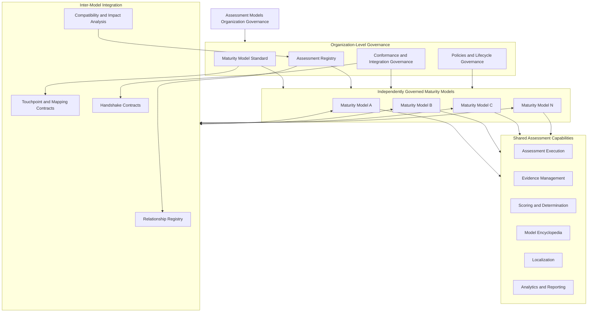
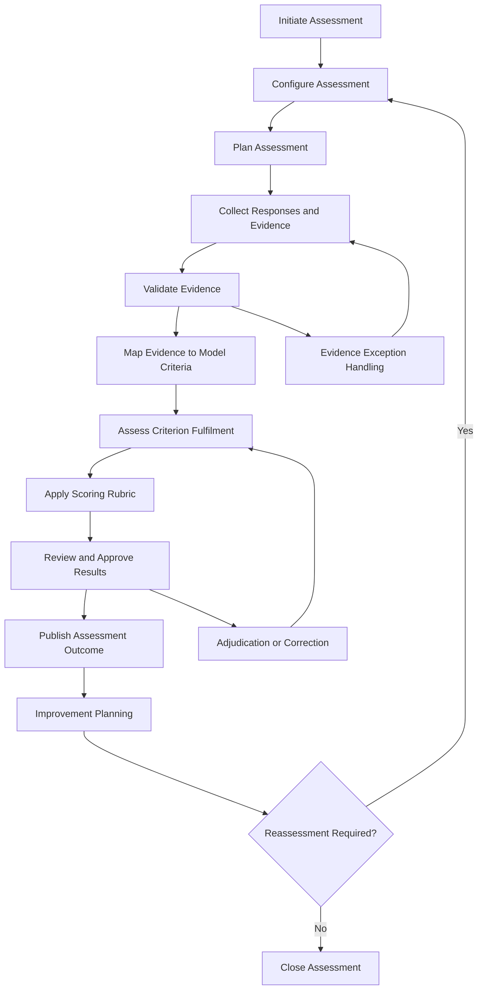
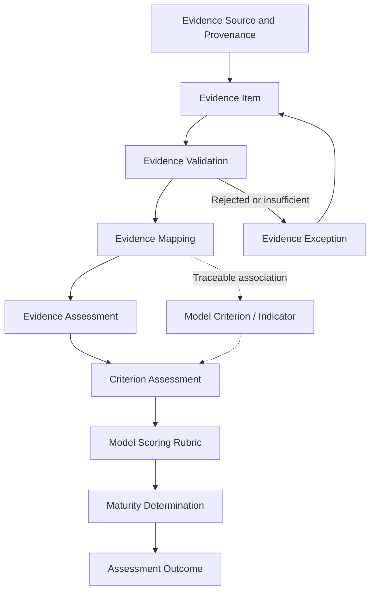
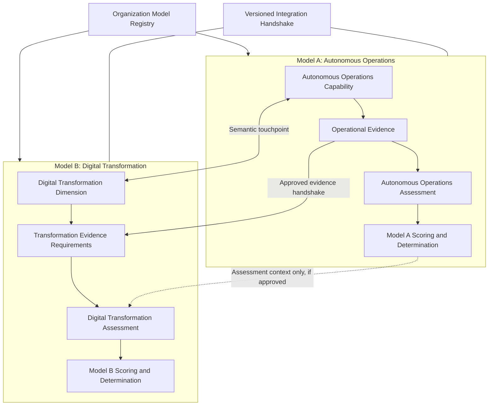
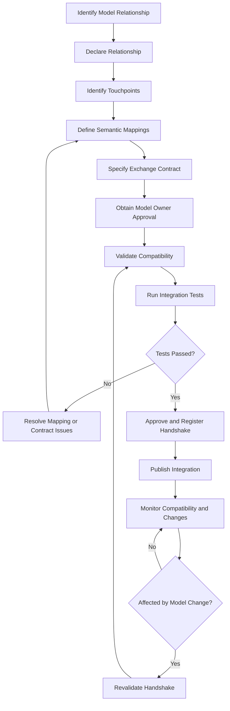
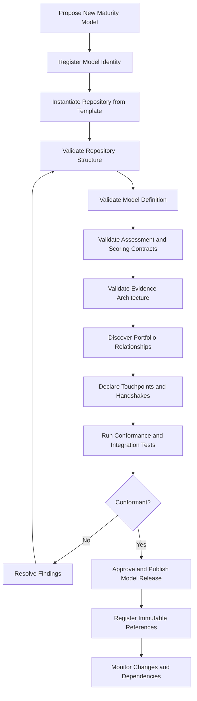
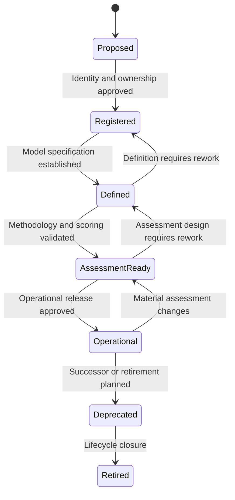

# Enterprise & Organization Assessment Models

**An open, governed ecosystem of enterprise and organizational maturity models, assessment systems, evidence frameworks and reusable assessment capabilities.**

Assessment Models provides the architecture, standards, tools and governance mechanisms for creating, publishing, operating and integrating independently managed maturity and assessment models.

Models are independently defined and versioned, but participate in a common ecosystem through standardized contracts, reusable components, a central registry, assessment and evidence interfaces, and automated conformance and integration processes.

The ecosystem is designed to make maturity models more than static frameworks of dimensions and maturity levels. Each model can become an operational assessment system with defined methodology, assessment instruments, scoring rules, evidence management, authoritative knowledge resources and governed relationships with other models.

---

## 1. Purpose and vision

Assessment Models exists to make maturity models and assessment systems reusable, operational, interoperable and continuously governable.

The ecosystem supports the complete lifecycle of an assessment model:

- Define and maintain domain-specific maturity models.
- Provide assessment methodologies, instruments and scoring rubrics.
- Collect, validate, map and apply assessment evidence.
- Publish authoritative model knowledge and documentation.
- Support multilingual and regional model variants.
- Establish governed relationships and operational handshakes between models.
- Generate assessment results, maturity profiles and improvement insights.
- Validate model quality, compatibility and ecosystem conformance automatically.
- Enable new maturity models to be introduced through a repeatable organizational onboarding process.

### 1.1 Architectural principle

> Each maturity model retains ownership of its domain semantics, assessment methodology and scoring logic while conforming to shared organizational standards and explicitly governed integration contracts.

This principle establishes two complementary objectives:

1. **Model independence:** Each model can be defined, released, assessed and maintained independently.
2. **Ecosystem interoperability:** Models can discover, reference, relate to and exchange governed information with other models.

Interoperability must not erase semantic differences between models. Shared infrastructure does not imply identical dimensions, maturity scales, assessment methodologies or scoring rules.

## 2. Ecosystem architecture

Assessment Models is organized around three connected architectural concerns.

### 2.1 Maturity Model Architecture

Defines what is assessed and what maturity means.

Includes:

- Model identity, scope and purpose.
- Domains, dimensions and subdimensions.
- Capabilities, criteria and indicators.
- Maturity levels and progression expectations.
- Model-specific terminology and concepts.
- Relationships to other models and reference frameworks.

### 2.2 Assessment Architecture

Defines how a maturity model is applied.

Includes:

- Assessment methodology and lifecycle.
- Questionnaires, checklists, interview guides and assessment instruments.
- Scoring rubrics, weighting and aggregation.
- Evidence collection, validation and mapping.
- Evidence application and traceability into scoring.
- Assessment determination, reporting and improvement planning.

### 2.3 Model Ecosystem Integration Architecture

Defines how independently governed models participate in a connected portfolio.

Includes:

- Model discovery and registration.
- Inter-model relationships and dependencies.
- Semantic mappings and assessment touchpoints.
- Evidence exchange and reuse agreements.
- Assessment and scoring exchange contracts.
- Version compatibility and change-impact analysis.
- Portfolio-level integration validation.

### 2.4 Conceptual ecosystem architecture

The following diagram illustrates the relationship between organizational governance, individual maturity models, shared assessment capabilities and inter-model integration.



The diagram represents the target logical architecture. It does not imply that all shared capabilities or integration services are already deployed.

## 3. Standard maturity-model repository architecture

Every maturity model should be maintained as an independently versioned and governed repository.

The repository should provide the complete model definition and the resources required to operationalize it, while consuming organization-level standards and reusable infrastructure through explicit, versioned contracts.

The repository architecture is governed by the [`maturity-model-standard`](https://github.com/Assessment Models/maturity-model-standard) repository and instantiated using [`maturity-model-template`](https://github.com/Assessment Models/maturity-model-template).

### 3.1 Reference repository structure

The following is the target reference architecture for an operational maturity-model repository.

```text
maturity-model-<name>/
│
├── README.md
├── model.yaml
├── standard.yaml
├── VERSION
├── CHANGELOG.md
├── LICENSE
│
├── model/
│   ├── identity.yaml
│   ├── scope.yaml
│   ├── domains/
│   ├── dimensions/
│   ├── subdimensions/
│   ├── capabilities/
│   ├── criteria/
│   ├── indicators/
│   ├── maturity-levels/
│   ├── progression/
│   └── relationships/
│
├── assessment/
│   ├── methodology/
│   ├── lifecycle/
│   ├── assessment-profiles/
│   ├── instruments/
│   ├── questionnaires/
│   ├── interview-guides/
│   ├── checklists/
│   ├── scoring/
│   ├── rubrics/
│   └── determination-rules/
│
├── evidence/
│   ├── evidence-model.yaml
│   ├── evidence-types/
│   ├── collection-guides/
│   ├── evidence-requirements/
│   ├── mappings/
│   ├── validation-rules/
│   ├── applicability-rules/
│   └── scoring-contributions/
│
├── encyclopedia/
│   ├── README.md
│   ├── concepts/
│   ├── domains/
│   ├── dimensions/
│   ├── capabilities/
│   ├── criteria/
│   ├── maturity-levels/
│   ├── assessment-guidance/
│   ├── evidence-guidance/
│   ├── examples/
│   └── faq/
│
├── localization/
│   ├── manifest.yaml
│   ├── en/
│   ├── fr/
│   └── es/
│
├── integration/
│   ├── integration-manifest.yaml
│   ├── relationships/
│   ├── touchpoints/
│   ├── mappings/
│   ├── handshakes/
│   └── compatibility/
│
├── schemas/
│   ├── model/
│   ├── assessment/
│   ├── evidence/
│   ├── localization/
│   └── integration/
│
├── examples/
│   ├── model/
│   ├── assessment/
│   ├── evidence/
│   ├── scoring/
│   └── integration/
│
├── generated/
│   ├── documentation/
│   ├── assessment-instruments/
│   └── reports/
│
├── tests/
│   ├── model/
│   ├── assessment/
│   ├── evidence/
│   ├── scoring/
│   ├── localization/
│   └── integration/
│
└── .github/
    └── workflows/
```

This is a logical reference architecture. The standard must define which components are mandatory, conditional or optional according to repository type and model lifecycle state.

### 3.2 Repository component responsibilities

| Repository area | Responsibility |
|---|---|
| `model/` | Normative domain model, constructs, criteria and maturity definitions |
| `assessment/` | Assessment methodology, instruments, scoring and determination |
| `evidence/` | Evidence collection, validation, mapping and scoring application |
| `encyclopedia/` | Authoritative explanatory knowledge and model guidance |
| `localization/` | Language variants and regional adaptations |
| `integration/` | Relationships, touchpoints, mappings and handshake declarations |
| `schemas/` | Machine-readable validation contracts |
| `examples/` | Reference implementations and worked examples |
| `generated/` | Generated documentation, instruments and reports |
| `tests/` | Model, assessment, evidence, scoring and integration validation |

### 3.3 Mandatory, conditional and optional components

The repository standard should distinguish the following requirements.

| Classification | Meaning | Examples |
|---|---|---|
| Mandatory | Required for all applicable maturity-model repositories | Identity, scope, version, model definition, standard declaration |
| Conditional | Required when the model claims or implements the relevant capability | Scoring rules, assessment instruments, localization, handshakes |
| Optional | Additional capabilities that enrich the model | Benchmarking, scenario simulation, advanced analytics |

A model may be registered before it is operationally assessment-ready. However, a model must not claim operational assessment readiness without the applicable methodology, assessment instruments, scoring definitions, evidence requirements and validation.

### 3.4 Model definition and repository metadata

The repository should maintain machine-readable definitions as authoritative inputs for validation, documentation generation and downstream integration.

Illustrative metadata:

```yaml
repository:
  id: maturity-model-autonomous-operations
  type: maturity-model
  standard:
    id: AM-MODEL-REPOSITORY-STANDARD
    version: "1.0.0"
    conformance: full

model:
  id: autonomous-operations
  name: Autonomous Operations Maturity Model
  version: "1.0.1"
  lifecycle_status: operational
  canonical_language: en

  ownership:
    organization: Assessment Models

  capabilities:
    assessment: true
    evidence_management: true
    scoring: true
    encyclopedia: true
    localization: false
    inter_model_integration: true
```

Values are illustrative. Actual metadata must agree with the model's published manifest, release and implementation evidence.

### 3.5 Source of truth and generated resources

The machine-readable model definition, assessment rules, evidence contracts and integration declarations are authoritative.

Generated documentation, assessment instruments, reports and diagrams must be reproducible from their authoritative definitions.

Generated content must not become an independently maintained source of conflicting semantics.

## 4. Assessment architecture and execution lifecycle

A maturity model becomes operational when its constructs can be applied through a defined assessment methodology.

Assessment Models establishes common execution interfaces while preserving model-specific assessment methods and scoring rules.

### 4.1 Assessment execution lifecycle

The standard assessment lifecycle consists of the following stages.

| Stage | Activity | Principal output |
|---|---|---|
| 1. Initiate | Establish assessment purpose, subject, ownership and scope | Assessment mandate |
| 2. Configure | Select model version, profile, dimensions, criteria, language and participants | Assessment configuration |
| 3. Plan | Define method, schedule, assessors, evidence needs and collection activities | Assessment plan |
| 4. Collect | Capture responses, evidence, observations and source references | Assessment inputs |
| 5. Validate | Evaluate evidence authenticity, relevance, currency and sufficiency | Validated evidence |
| 6. Map | Associate evidence and responses with applicable model constructs | Evidence mappings |
| 7. Assess | Evaluate criterion fulfilment and maturity expectations | Criterion assessments |
| 8. Score | Apply the model's rubric, weights, aggregation and determination rules | Scoring results |
| 9. Review | Conduct quality review, adjudication and approval | Approved assessment |
| 10. Publish | Produce results, findings, traceability and improvement recommendations | Assessment report |
| 11. Improve | Track actions and reassessment requirements | Improvement plan |

### 4.2 Assessment execution diagram



The lifecycle supports iteration. Evidence gaps, rejected evidence, conflicting findings and assessment exceptions may require additional collection or review.

### 4.3 Assessment configuration

An assessment instance should identify at least:

- Assessment identifier.
- Model identifier and immutable version.
- Assessment subject and scope.
- Assessment profile.
- Applicable dimensions and criteria.
- Assessment methodology and version.
- Scoring rubric and version.
- Assessment language.
- Assessors and approval roles.
- Evidence requirements.
- Start, completion and review dates.

An assessment must retain the exact versions of the model and its relevant contracts used to produce its result.

### 4.4 Assessment determination

The model's determination rules define how individual criterion assessments become dimension-level and overall maturity outcomes.

Possible determination mechanisms include:

- Ordinal maturity-level assignment.
- Weighted or unweighted aggregation.
- Mandatory criteria and progression gates.
- Threshold-based qualification.
- Minimum evidence sufficiency.
- Confidence or assurance qualifications.
- Exception and adjudication rules.

Not every model needs every mechanism. The applicable determination logic must be declared by the model and must be reproducible.

## 5. Evidence management and evidence-to-score traceability

Evidence is a first-class, governed assessment entity.

It is not merely an attachment to a questionnaire response. It provides the substantiation for assessment findings and the basis on which scoring decisions can be explained, reviewed and reproduced.

### 5.1 Evidence management concepts

| Concept | Definition |
|---|---|
| Evidence Item | A uniquely identifiable evidence object |
| Evidence Source | The origin or producer of the evidence |
| Evidence Type | The classification of evidence, such as document, metric, record, interview or observation |
| Evidence Claim | The assertion that the evidence is intended to support |
| Evidence Mapping | The relationship between evidence and model criteria, indicators or dimensions |
| Evidence Validation | The evaluation of authenticity, relevance, currency and completeness |
| Evidence Applicability | The determination that evidence is relevant to a particular assessment scope and criterion |
| Evidence Assessment | The evaluation of evidence strength, coverage, sufficiency and consistency |
| Evidence Contribution | The governed effect of evidence on a scoring determination |
| Evidence Provenance | The traceable history of evidence origin, handling and transformation |

### 5.2 Evidence-to-score traceability model

The evidence-to-score process must distinguish five separate activities:

1. **Collection:** Obtain evidence from an identified source.
2. **Validation:** Establish its authenticity, relevance, currency and sufficiency.
3. **Mapping:** Associate it with the applicable model constructs.
4. **Assessment:** Determine what the evidence demonstrates and how strongly it substantiates the criterion.
5. **Scoring application:** Apply the model's scoring rules to the assessed result.

Mapping evidence to a criterion does not mean the criterion has been satisfied. Evidence validation does not automatically establish a maturity level. The model's assessment and scoring rules determine the outcome.



### 5.3 Evidence-to-score relationship

The following relationship must be traceable:

```text
Assessment Outcome
    └── Maturity Determination
          └── Scoring Result
                └── Scoring Rule
                      └── Criterion Assessment
                            └── Evidence Assessment
                                  └── Evidence Mapping
                                        └── Evidence Item
                                              └── Evidence Source
```

Every material scoring determination should be explainable by traversing this chain.

The assessment record should retain:

- Evidence identifiers and versions.
- Source and provenance information.
- Validation decisions and reasons.
- Applicable criterion and indicator identifiers.
- Mapping method and approval status.
- Evidence assessment findings.
- Scoring rule and rubric version.
- Weighting and aggregation inputs.
- Overrides, exceptions and adjudication records.
- Final determination and confidence qualifications.

### 5.4 Evidence contribution and scoring

An evidence contribution is not necessarily a numerical score.

Depending on the model, evidence may:

- Substantiate fulfilment of a criterion.
- Demonstrate partial fulfilment.
- Establish that a mandatory requirement is not met.
- Provide corroboration or additional confidence.
- Identify contradictory findings.
- Demonstrate that evidence is insufficient or not applicable.

The model-specific scoring contract determines how these findings affect scoring.

For example, a model may use a five-level ordinal scale and weighted dimension aggregation, while another may use mandatory thresholds and conditional progression. The shared evidence framework supports both without imposing one scoring method on all models.

### 5.5 Evidence reuse across models

Evidence may be referenced by more than one model when the relevant evidence-sharing, applicability and authorization conditions are satisfied.

However:

- Evidence reuse does not imply criterion equivalence.
- Evidence reuse does not imply score equivalence.
- The receiving model must evaluate evidence against its own requirements.
- Access permissions and confidentiality restrictions remain applicable.
- Evidence freshness and validity must be checked in the receiving assessment context.

This enables efficient evidence reuse while preserving the independence of each model's assessment authority.

## 6. Model encyclopedia and authoritative knowledge

Every maturity model should provide an authoritative, navigable knowledge resource.

The model encyclopedia is the explanatory and educational layer of the model. It should be linked to the machine-readable model definition and stable identifiers.

It should cover:

- Model purpose, scope and boundaries.
- Concepts and terminology.
- Domains, dimensions and capabilities.
- Criteria, indicators and requirements.
- Maturity levels and progression expectations.
- Assessment methodology and interpretation.
- Scoring explanations and worked examples.
- Evidence expectations and examples.
- Assessment scenarios and guidance.
- Relationships to other maturity models.
- Frequently asked questions.
- References, provenance and change history.

The encyclopedia should be publishable as repository documentation and, where appropriate, as a generated documentation website.

The following distinction is important:

| Resource | Authority and purpose |
|---|---|
| Model specification | Normative machine-readable model definition |
| Assessment specification | Normative assessment methodology and instruments |
| Scoring contract | Normative scoring and determination rules |
| Evidence specification | Normative evidence requirements and application rules |
| Model encyclopedia | Authoritative explanatory knowledge |
| Assessment report | Record of a specific assessment execution |

## 7. Multilingual and regional model variants

Language support is a core model architecture concern.

Each model should maintain a canonical language and stable, language-independent identifiers for its elements.

Localized variants may provide translated labels, descriptions, assessment instruments, explanatory guidance and regional adaptations.

Illustrative localization manifest:

```yaml
model:
  id: autonomous-operations
  canonical_language: en

localization:
  strategy: canonical-reference

  variants:
    en:
      status: authoritative
      model_version: "1.0.1"

    fr:
      status: reviewed
      source_language: en
      source_model_version: "1.0.1"

    es:
      status: draft
      source_language: en
      source_model_version: "1.0.1"
```

Localization governance must distinguish:

- Canonical content.
- Translation.
- Regional adaptation.
- Jurisdiction-specific requirements.
- Translation review and approval.
- Alignment with canonical model versions.

Translations must not silently change model identity, scoring semantics, criterion identifiers or maturity definitions.

## 8. Inter-model relationships, touchpoints and handshakes

Assessment Models is intended to be a connected portfolio of independently governed maturity models.

Models may assess different but related aspects of an enterprise, share concepts, provide complementary evidence or depend on other models for contextual information.

These relationships must be explicit, machine-readable, versioned and governed.

### 8.1 Relationship types

The organization should establish a controlled vocabulary for inter-model relationships.

| Relationship type | Definition | Example |
|---|---|---|
| Dependency | One model requires a concept, definition or determination from another model | Model B requires a capability definition maintained by Model A |
| Complementary | Two models assess different but related aspects of a broader concern | An operations model complements a technology maturity model |
| Overlapping | Models assess some of the same or closely related concepts | Two models include related governance criteria |
| Enabling | One model assesses capabilities that support outcomes in another | Technology capability enables an operational outcome |
| Contributory | An outcome or evidence from one model may contribute information to another model's assessment | An operations assessment provides relevant evidence to a transformation assessment |
| Cross-referencing | Models reference one another without requiring operational exchange | One model points to related assessment guidance |
| Supersession | One model replaces or succeeds another | A new model version or successor model replaces an earlier model |
| Derived-from | One model has a documented derivation or specialization relationship with another | A domain-specific model is derived from a broader model |

Relationship declarations must identify directionality, scope, rationale, ownership and applicable model versions.

A relationship declaration alone does not authorize evidence sharing or scoring exchange. Those require explicit integration contracts.

### 8.2 Touchpoints

A touchpoint identifies the specific model elements at which two models intersect.

A touchpoint may connect:

- A capability to a dimension.
- A criterion to another criterion.
- An indicator to a requirement.
- An evidence requirement to another model's evidence source.
- An assessment outcome to another model's assessment context.
- A maturity construct to a related construct in another model.

Touchpoints must specify the relationship between the elements, not merely assert that two models are related.

A touchpoint should contain:

- Unique identifier.
- Source model and element.
- Target model and element.
- Relationship type.
- Mapping strength or equivalence classification.
- Rationale and supporting references.
- Evidence exchange permissions, where applicable.
- Scoring exchange permissions, where applicable.
- Approval and lifecycle status.
- Applicable source and target versions.

### 8.3 Touchpoint mapping classifications

The organization should distinguish different forms of semantic correspondence.

| Classification | Meaning |
|---|---|
| Exact | The constructs have equivalent intended meaning and scope |
| Equivalent | The constructs are sufficiently equivalent for the declared integration purpose |
| Partial | One construct covers only part of another construct's meaning or scope |
| Broader-than | The source construct covers a wider concept than the target |
| Narrower-than | The source construct covers a subset of the target |
| Related | The constructs are associated but not equivalent |
| No-match | A reviewed mapping has determined that no valid correspondence exists |

These classifications must not be treated as interchangeable. In particular, a `related` or `partial` mapping must not be interpreted as permission to transfer a maturity score.

### 8.4 Handshakes

A handshake is a governed operational agreement between two models.

It specifies how the models interact through their declared touchpoints and mappings.

A handshake is more than a relationship declaration. It establishes:

1. Source and target model identities.
2. Immutable source and target versions.
3. Approved touchpoints and mappings.
4. Information and evidence that may be exchanged.
5. Transformation and interpretation rules.
6. Evidence acceptance conditions.
7. Whether assessment determinations may be consumed.
8. Whether score exchange is permitted.
9. Compatibility requirements.
10. Ownership, approval and lifecycle management.
11. Failure, exception and change-notification handling.

### 8.5 Handshake contract types

| Handshake | Purpose |
|---|---|
| Discovery handshake | Discover models, versions and available interfaces |
| Semantic handshake | Establish meaning and mappings between model constructs |
| Evidence handshake | Govern evidence references, exchange and acceptance |
| Assessment handshake | Exchange assessment context and determinations |
| Scoring handshake | Exchange scoring outputs under explicit compatibility rules |
| Lifecycle handshake | Notify dependent models of changes, deprecation or incompatibility |

Not every model relationship requires every handshake type.

The applicable handshakes depend on the intended integration and must be explicitly declared.

### 8.6 Two models participating in an ecosystem

The following example illustrates how two independently governed maturity models can participate in an ecosystem.

Consider:

- **Model A: Autonomous Operations Maturity Model**
- **Model B: Digital Transformation Maturity Model**

Model A assesses autonomous operational capabilities, while Model B assesses broader digital transformation dimensions.

The models are complementary. A capability assessed by Model A may provide relevant evidence for a dimension assessed by Model B.

However, the models do not automatically share maturity levels or scoring semantics.



In this example:

1. Model A declares a capability relevant to Model B's transformation dimension.
2. A semantic touchpoint records the relationship and mapping strength.
3. An evidence handshake establishes whether selected evidence can be referenced or exchanged.
4. Model B evaluates that evidence against its own criterion and evidence requirements.
5. Model B applies its own scoring rubric.
6. Model A's maturity score is not automatically transferred into Model B.

This is a controlled integration, not an implicit merger of the two models.

### 8.7 Example touchpoint declaration

The following YAML illustrates a partial, contributory mapping.

```yaml
touchpoint:
  id: TP-AO-DT-001

  source:
    model: autonomous-operations
    version: "1.0.1"
    element: AO-CAP-001
    element_type: capability

  target:
    model: digital-transformation
    version: "2.0.0"
    element: DT-DIM-003
    element_type: dimension

  relationship: contributory
  mapping:
    classification: partial
    rationale: >
      The autonomous operations capability provides
      evidence relevant to the target transformation
      dimension, but does not cover its full scope.

  exchange_permissions:
    semantic_reference: true
    evidence_reference: true
    evidence_transfer: conditional
    assessment_determination: false
    score_transfer: false

  governance:
    status: approved
    owner: Assessment Models
```

Identifiers and versions are illustrative. Actual touchpoints must reference published model elements and approved releases.

### 8.8 Example handshake declaration

```yaml
handshake:
  id: HS-AO-DT-001
  type: evidence

  participants:
    source:
      model: autonomous-operations
      version: "1.0.1"

    target:
      model: digital-transformation
      version: "2.0.0"

  touchpoints:
    - TP-AO-DT-001

  exchange:
    permitted_information:
      - evidence_reference
      - evidence_provenance
      - evidence_validation_status

    prohibited_information:
      - source_score_as_target_score

  acceptance:
    target_model_validation_required: true
    applicability_check_required: true
    permission_check_required: true

  governance:
    owner: Assessment Models
    approval_status: approved

  compatibility:
    source_version: "1.0.1"
    target_version: "2.0.0"
```

### 8.9 Handshake lifecycle



### 8.10 Inter-model integration principles

The following principles are normative architectural safeguards:

- A relationship does not automatically authorize information exchange.
- A touchpoint does not automatically establish semantic equivalence.
- A mapping does not automatically establish evidence applicability.
- Evidence reuse does not automatically establish criterion fulfilment.
- Assessment determination exchange does not automatically establish score equivalence.
- Score transfer requires an explicit, approved and compatible scoring contract.
- All operational handshakes must identify immutable model versions.
- Changes to either participating model must trigger compatibility review where applicable.

## 9. Registry, automation and ecosystem conformance

The ecosystem requires a common mechanism to discover, register, validate and integrate maturity models.

The [`assessment-registry`](https://github.com/Assessment Models/assessment-registry) provides the foundation for asset discovery, immutable references, dependencies and compatibility.

The [`assessment-ci`](https://github.com/Assessment Models/assessment-ci) provides the foundation for reusable validation and ecosystem integration workflows.

The [`maturity-model-standard`](https://github.com/Assessment Models/maturity-model-standard) governs repository requirements, schemas, templates, validators and conformance.

### 9.1 Model onboarding lifecycle



### 9.2 Conformance architecture

The organization distinguishes several complementary forms of validation.

| Validation level | Purpose |
|---|---|
| Local repository validation | Structure, syntax, schemas, internal references and tests |
| Model validation | Semantic completeness and model-specific consistency |
| Assessment conformance | Assessment methodology, instruments, scoring and determination contracts |
| Evidence conformance | Evidence definitions, mappings, validation and traceability |
| Contract conformance | Validation against pinned OpenDEA contract releases |
| Repository-standard conformance | Compliance with the Assessment Models repository standard |
| Ecosystem integration | Registry integrity, dependencies, touchpoints, handshakes and compatibility |

Repository-standard conformance is independently identifiable. It does not replace model, assessment or ecosystem validation.

### 9.3 Automation opportunities

The architecture should enable reusable automation for:

- Repository scaffolding and onboarding.
- Model metadata and schema validation.
- Assessment instrument generation.
- Evidence collection template generation.
- Evidence mapping validation.
- Scoring and determination test execution.
- Model encyclopedia generation.
- Multilingual coverage and synchronization checks.
- Relationship and touchpoint validation.
- Handshake compatibility testing.
- Portfolio dependency and change-impact analysis.
- Assessment report generation.
- Conformance dashboards and portfolio analytics.

Automation may identify candidate semantic mappings and potential model overlaps. Approval of consequential semantic equivalence, evidence exchange and scoring exchange remains subject to designated governance.

## 10. Organizational governance and OpenDEA relationship

Assessment Models is an independent ecosystem authority.

It does not own or replace the OpenDEA metamodel.

The canonical engineering authority is [`technehub-labs/dea-metamodel`](https://github.com/technehub-labs/dea-metamodel), which publishes versioned contracts for assessment, maturity models, maturity scales, scoring, conformance and benchmarking.

The relationship is contractual:

- OpenDEA publishes canonical engineering contracts.
- Assessment Models governs its portfolio of conformant assessment assets.
- Individual repositories own their model definitions and domain-specific assessment logic.
- Assessment consumers use immutable, versioned model releases.

The dependency is contractual, not structural. Each asset declares the contract version it supports and consumes pinned, immutable releases.

### 10.1 Governance responsibilities

| Governance level | Responsibility |
|---|---|
| Organization | Portfolio policies, shared standards, registry and lifecycle governance |
| Shared standards | Repository, metadata, assessment, evidence and integration contracts |
| Individual model | Domain semantics, methodology, instruments, scoring and model-specific integrations |
| Assessment implementation | Assessment execution, evidence instances, findings, results and improvement plans |

The organization governs common interfaces and integration rules. Individual model owners retain authority over their model-specific semantics and scoring decisions.

## 11. Repository portfolio

### Maturity models

Independently versioned models defining domain-specific maturity constructs.

- [`maturity-model-digital-transformation`](https://github.com/Assessment Models/maturity-model-digital-transformation)
- [`maturity-model-digital-transformation-operationalized`](https://github.com/Assessment Models/maturity-model-digital-transformation-operationalized)
- [`maturity-model-modernization`](https://github.com/Assessment Models/maturity-model-modernization)
- [`maturity-model-technology`](https://github.com/Assessment Models/maturity-model-technology)
- [`maturity-model-operations`](https://github.com/Assessment Models/maturity-model-operations)
- [`maturity-model-services-delivery`](https://github.com/Assessment Models/maturity-model-services-delivery)
- [`maturity-model-autonomous-operations`](https://github.com/Assessment Models/maturity-model-autonomous-operations)

### Standards and scaffolding

- [`maturity-model-standard`](https://github.com/Assessment Models/maturity-model-standard) — normative repository standard, schemas, conformance workflow and portfolio conformance registry.
- [`maturity-model-template`](https://github.com/Assessment Models/maturity-model-template) — reusable template for new maturity-model repositories.

### Integration and validation

- [`assessment-registry`](https://github.com/Assessment Models/assessment-registry) — asset registration, immutable references, dependencies and compatibility.
- [`assessment-ci`](https://github.com/Assessment Models/assessment-ci) — cross-repository validation and ecosystem integration.
- [`maturity-components`](https://github.com/Assessment Models/maturity-components) — reusable, versioned maturity components.

### Catalogs and assessment tools

- [`dea-catalog-maturity-models`](https://github.com/Assessment Models/dea-catalog-maturity-models) — Enterprise Architecture maturity model catalog.
- [`dea-catalog-assessment-tools`](https://github.com/Assessment Models/dea-catalog-assessment-tools) — assessment tools catalog.
- [`dea-assessment-modernization`](https://github.com/Assessment Models/dea-assessment-modernization)
- [`dea-assessment-technology`](https://github.com/Assessment Models/dea-assessment-technology)
- [`dea-assessment-operations`](https://github.com/Assessment Models/dea-assessment-operations)
- [`dea-assessment-services-delivery`](https://github.com/Assessment Models/dea-assessment-services-delivery)

See the [assessment registry](https://github.com/Assessment Models/assessment-registry) for the authoritative asset inventory and version references.

## 12. Model lifecycle and contribution

New models are proposed through the registry and accepted through the organization's governance process.

A model lifecycle should distinguish registration, implementation and operational readiness.

Illustrative lifecycle:



These are model lifecycle states, not repository conformance levels or maturity levels.

Every model must establish:

- A unique identity and accountable owner.
- A declared scope and domain.
- A versioned machine-readable definition.
- Applicable assessment and scoring contracts.
- Explicit evidence requirements and traceability.
- A model encyclopedia or equivalent authoritative documentation.
- Explicit dependencies and component reuse.
- A conformance declaration.
- Documented relationships to other relevant models.

Model changes are independently versioned and governed. Changes that affect shared components, mappings, evidence contracts or dependent models must undergo compatibility and impact assessment.

## 13. Roadmap

The ecosystem's architectural direction is to progress from repository and contract conformance toward fully operational and interoperable maturity-model systems.

Key areas of evolution include:

- Complete assessment methodology and instrument contracts.
- Reusable evidence management and evidence-to-score traceability.
- Model encyclopedia generation and publication.
- Multilingual and regional model variants.
- Typed inter-model relationships, touchpoints and handshake contracts.
- Automated integration and compatibility testing.
- Portfolio-wide change-impact analysis.
- Assessment analytics, benchmarking and improvement planning.

Implementation status is governed through approved change requests and the corresponding repository roadmaps.

A capability described as part of the target architecture must not be interpreted as implemented until its implementation and conformance evidence are published.

## 14. Architectural principles

The following principles govern the evolution of the ecosystem:

1. **Independent model ownership:** Models retain authority over their domain semantics and assessment logic.
2. **Contract-first interoperability:** Shared interfaces and exchanges are explicitly specified and versioned.
3. **Machine-readable authority:** Normative definitions are maintained in structured, validated resources.
4. **Evidence-based determination:** Material assessment outcomes are traceable to evidence and scoring rules.
5. **Scoring independence:** Models retain their own maturity scales, rubrics and determination rules.
6. **Governed evidence reuse:** Evidence reuse is subject to applicability, permissions and receiving-model validation.
7. **Stable semantic identity:** Model elements retain stable identifiers across versions and language variants.
8. **Explicit integration:** Relationships, touchpoints, mappings and handshakes are declared and governed.
9. **Immutable dependencies:** Released integrations reference exact model and contract versions.
10. **Automated conformance:** Reusable validation and integration checks support continuous ecosystem integrity.
11. **Controlled evolution:** Model additions, changes and retirements follow explicit governance and change-impact assessment.

---

**Assessment Models: independently governed models, consistently engineered, operationally assessable and interoperable by design.**
